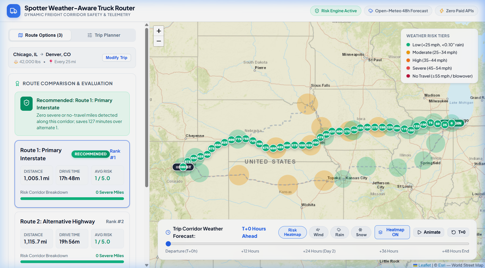

# Spotter: Weather-Aware Truck Routing Web App

A production-ready full-stack application built with **React** and **Django** that helps commercial truck drivers and fleet dispatchers choose the safest, most efficient routes based on real-time weather forecasts, load weight vulnerability, and travel time.



---

## 🌟 Key Features

1. **Executive Home & Landing Portal**:
   - High-impact landing page introducing the freight safety platform, architecture, and live system telemetry.
   - **One-Click Freight Corridor Analysis**: Instant launcher cards for major US trucking corridors (*I-80 Midwest*, *Rockies Mountain Pass*, *South Central Arterial*, *Midwest-Southeast Express*).
   - **Interactive Safety Matrix**: Clear presentation of the 5 weather risk tiers, payload vulnerability blowover rules, and the 4-tier recommendation hierarchy.
   - Seamless navigation between the **Home Overview** and the **Interactive Dispatch Dashboard**.

2. **3-Route Alternative Generation**:
   - Generates 3 distinct route options using the Open Source Routing Machine (OSRM) highway network engine.
   - Decodes full geometries and calculates distances and driving durations.

2. **Equidistant Weather Sampling (10 / 25 / 50 miles)**:
   - Resamples polyline coordinates at exact spatial intervals selected by the driver.
   - Computes estimated arrival times (ETA) at every checkpoint along the trip corridor.

3. **Zero-Paid API Architecture**:
   - **Routing**: Open Source Routing Machine (OSRM) driving API (Zero cost, no API keys).
   - **Weather**: [Open-Meteo API](https://open-meteo.com) (Free open-access hourly forecasts: wind speed at 10m, precipitation rate, and snowfall).
   - **Geocoding**: OpenStreetMap Nominatim with local hub caching.

4. **Exact Risk & Load Weight Vulnerability Engine**:
   - Classifies weather into 5 tiers: **Low**, **Moderate**, **High**, **Severe**, and **No Travel**.
   - Applies critical truck payload safety overrides:
     - $\ge 55\text{ mph}$ wind $\rightarrow$ **No Travel** for *any* load.
     - $45–54\text{ mph}$ wind $+ >30,000\text{ lb}$ load $\rightarrow$ **No Travel** (blowover hazard).
     - $35–44\text{ mph}$ wind $+ >40,000\text{ lb}$ load $\rightarrow$ **Severe** (crosswind steering hazard).

5. **4-Tier Route Recommendation Hierarchy**:
   - **Priority 1**: Fewest Severe miles (including No Travel miles)
   - **Priority 2**: Fewest High miles
   - **Priority 3**: Lowest average risk score
   - **Priority 4**: Shortest travel times

6. **Interactive Map & Corridor Weather Heatmap**:
   - Leaflet map rendering 3 routes, selected route highlighted in cyan, and circular checkpoint pins color-coded by severity.
   - Clickable checkpoint popups showing Mile Marker, ETA, Wind (mph), Rain (in/hr), Snow (in/hr), Temperature (°F), and active load warnings.
   - **0–48 Hour Forecast Scrubber Slider**: dynamic weather density heatmap along the trip corridor with automated animation playback and layer toggling (Risk, Wind, Rain, Snow).
   - Collapsible **Checkpoint Telemetry Log** table for turn-by-turn inspection.

---

## 📊 Weather Risk & Load Thresholds

### Base Condition Thresholds
| Condition | Low (1) | Moderate (2) | High (3) | Severe (4) | No Travel (5) |
|---|---|---|---|---|---|
| **Wind** | $<25\text{ mph}$ | $25–34\text{ mph}$ | $35–44\text{ mph}$ | $45–54\text{ mph}$ | $\ge 55\text{ mph}$ |
| **Rain** | $<0.10\text{ in/hr}$ | $0.10–0.25\text{ in/hr}$ | $0.25–0.50\text{ in/hr}$ | $0.50–1.00\text{ in/hr}$ | $>1.00\text{ in/hr}$ |
| **Snow** | $<0.5\text{ in/hr}$ | $0.5–1.0\text{ in/hr}$ | $1.0–2.0\text{ in/hr}$ | $2.0–3.0\text{ in/hr}$ | $>3.0\text{ in/hr}$ |

### Load Vulnerability Rules
- $\ge 55\text{ mph} \rightarrow$ **No Travel** for any load
- $45–54\text{ mph} + >30,000\text{ lb} \rightarrow$ **No Travel**
- $35–44\text{ mph} + >40,000\text{ lb} \rightarrow$ **Severe**

---

## 🛠️ Tech Stack & Directory Structure

```
spotter_ai_fullstackdev/
├── backend/                  # Django project configuration & settings
│   ├── settings.py           # CORS, REST Framework, Apps
│   └── urls.py               # API route routing
├── routing_core/             # Core routing and risk application
│   ├── services/
│   │   ├── geocoding_service.py # Nominatim OSM & freight hub caching
│   │   ├── routing_service.py   # OSRM 3-route generator with fallback
│   │   ├── sampling_service.py  # Equidistant 10/25/50 mi sampling & ETA
│   │   ├── weather_service.py   # Open-Meteo batch hourly forecast client
│   │   └── risk_engine.py       # Weather risk matrix, load rules, ranking
│   ├── views.py              # REST API endpoints
│   ├── urls.py               # API endpoint definitions
│   └── tests.py              # Comprehensive automated test suite
├── frontend/                 # React + Vite application
│   ├── src/
│   │   ├── components/
│   │   │   ├── Header.jsx           # App branding & status badges
│   │   │   ├── TripForm.jsx         # Inputs, weight slider, interval pills
│   │   │   ├── RouteComparison.jsx  # 3 route cards, recommendation banner
│   │   │   ├── TruckMap.jsx         # Leaflet map, pins, popups, heatmap
│   │   │   ├── ForecastSlider.jsx   # 0-48h forecast scrubber & play loop
│   │   │   └── CheckpointDrawer.jsx # Turn-by-turn checkpoint telemetry table
│   │   ├── App.jsx                  # Main dashboard controller
│   │   └── index.css                # Modern logistics telemetry dark theme
├── requirements.txt          # Python dependencies
├── start.bat                 # 1-click Windows runner
├── start.sh                  # 1-click Linux/macOS runner
└── README.md
```

---

## 🚀 Quickstart Guide

### Prerequisites
- Python 3.10+
- Node.js 18+ and npm

### 1. Backend Setup
```bash
# From workspace root
python -m venv venv

# Activate venv:
# Windows:
.\venv\Scripts\activate
# Linux/macOS:
source venv/bin/activate

# Install dependencies
pip install -r requirements.txt

# Run migrations
python manage.py migrate

# Start backend server (port 8000)
python manage.py runserver 127.0.0.1:8000
```

### 2. Frontend Setup
```bash
# In a new terminal
cd frontend
npm install
npm run dev
```
Open **[http://127.0.0.1:5173/](http://127.0.0.1:5173/)** in your browser.

Or simply double-click `start.bat` on Windows!

---

## 🧪 Testing & Verification

The project includes unit and integration tests covering:
- Base wind, rain, and snow risk thresholds
- Truck payload rules ($\ge 55$ mph, $>30$k lbs, $>40$k lbs)
- Recommendation priority ordering (1. Fewest Severe miles, 2. Fewest High miles, 3. Lowest average risk, 4. Shortest travel time)
- Spatial sampling at 10, 25, 50 miles with ETA progression
- End-to-end API pipeline between Chicago, IL and Denver, CO

Run the test suite:
```bash
.\venv\Scripts\python manage.py test routing_core
```

Verify frontend bundle compilation:
```bash
cd frontend && npm run build
```

---

## ☁️ Deployment Guide (All-in-One on Vercel)

The entire full-stack application (Django REST API + React Vite frontend) is pre-configured for seamless serverless deployment on **Vercel** as a single unified monorepo.

### Option A: 1-Click via Vercel Web Dashboard (Recommended)

1. Navigate to your [Vercel Dashboard](https://vercel.com/dashboard).
2. Click **Add New...** → **Project**.
3. Under **Import Git Repository**, select `Apurav-sharma/routing-app`.
4. Configure Project Settings:
   - **Framework Preset**: *Other* or *Vite*
   - **Root Directory**: `./` (leave default)
   - **Build Command**: `cd frontend && npm install && npm run build` (auto-detected via `vercel.json`)
   - **Output Directory**: `frontend/dist` (auto-detected via `vercel.json`)
5. Click **Deploy**.
6. Vercel will install Python dependencies from `requirements.txt`, compile the React frontend into `frontend/dist`, and route `/api/*` to the Django serverless WSGI runtime in `api/index.py`.

### Option B: Deploy via Vercel CLI

```bash
# 1. Login to Vercel
npx vercel login

# 2. Deploy directly to production
npx vercel --prod
```

### Verifying the Live Deployment
- Frontend App: `https://<your-project>.vercel.app/`
- Healthcheck Endpoint: `https://<your-project>.vercel.app/api/health/`
- Route Analysis Endpoint: `https://<your-project>.vercel.app/api/routes/analyze/`

---

## 🎙️ 5–10 Min Loom Walkthrough Guide

Use this script structure when recording the demo walkthrough video:

1. **Introduction (1 min)**:
   - Introduce the app purpose: Safe commercial truck routing combining real-time weather forecasts, gross vehicle weight (GVW) vulnerability, and travel time.
   - Highlight the **zero-paid API architecture** powered entirely by open services: Open Source Routing Machine (OSRM) highway network engine, Open-Meteo hourly weather forecasts, and OpenStreetMap Nominatim geocoding.

2. **Executive Home Portal (1.5 min)**:
   - Tour the **Home Overview** landing page:
     - Hero banner and architecture flow diagram.
     - 4 Quick-Launch Freight Corridors (*I-80 Midwest*, *Rockies Mountain Pass*, *South Central Arterial*, *Midwest-Southeast Express*).
     - Interactive **Weather & Payload Safety Matrix** explaining the 5 risk tiers, the 4-tier route recommendation hierarchy, and blowover rules.
   - Click **Open Dispatch Router** or one of the quick launchers to seamlessly transition into the full-screen interactive dashboard.

3. **Trip Configuration & Presets (1.5 min)**:
   - Demonstrate the Trip Planner panel:
     - Origin (*Chicago, IL*), Destination (*Denver, CO*), Departure Time, and Equidistant Sampling selector (10, 25, 50 mi).
     - Drag the **Gross Vehicle Weight** slider:
       - Move to $42,000\text{ lbs}$ to demonstrate the active warning: *"Heavy Payload: 35–44 mph winds escalate from High to SEVERE"*.
       - Move above $30,000\text{ lbs}$ to show the $45–54\text{ mph}$ blowover hazard override.
       - Move down to $25,000\text{ lbs}$ to show standard base thresholds.

4. **Route Analysis & Recommendation Logic (2 mins)**:
   - Click **Analyze Safe Routes**.
   - Review the **Recommended Route banner** explaining the exact safety rationale based on the 4-tier decision priority:
     1. Fewest Severe miles (including No Travel miles).
     2. Fewest High miles.
     3. Lowest average risk score.
     4. Shortest travel time.
   - Compare the 3 distinct routes using the horizontal switcher tabs:
     - Route 1 (Primary / Recommended), Route 2 (Alternative), and Route 3 (Bypass).
     - Point out the stacked risk breakdown bar (Low, Mod, High, Severe, No Travel).
     - Demonstrate live polyline highlighting on the map when switching between routes.

5. **Interactive Map & Checkpoint Telemetry (2 mins)**:
   - Highlight the clean, full-bleed Esri World Street map view with zero watermarks.
   - Zoom in on the color-coded checkpoint micro-dots along the route.
   - Click a checkpoint marker to show the detailed telemetry popup (Mile Marker, ETA, Wind speed in mph, Rain rate, Snow rate, Temperature, and Active load warnings).
   - Toggle the collapsible **Checkpoint Telemetry Log** table at the bottom of the screen to inspect turn-by-turn data across the entire corridor.

6. **0–48 Hour Weather Forecast Heatmap Scrubber (1.5 min)**:
   - Showcase the floating frosted-glass forecast scrubber dock at the bottom of the map.
   - Drag the scrubber from $T+0\text{h}$ to $T+24\text{h}$ and $T+48\text{h}$.
   - Click the **Play / Pause** button to demonstrate animated weather system evolution along the freight corridor.
   - Toggle between layer modes: **Corridor Risk**, **Wind Speed (mph)**, **Precipitation (in/hr)**, and **Snowfall (in/hr)**.

7. **Conclusion & Architecture Summary (30s)**:
   - Conclude by highlighting the modular clean architecture in Django (`routing_service`, `weather_service`, `risk_engine`, `sampling_service`), comprehensive automated test coverage, and responsive light-theme React interface.
